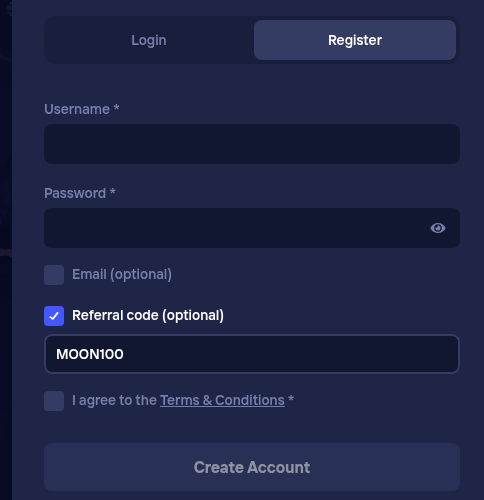

# Duel referral code: MOON100 (as of November 2026)

**The Duel referral code is MOON100.** On the Duel Register form, tick "Referral code (optional)" and type MOON100 before you create the account.

## Where is the code box on Duel?

It sits at the bottom of the Register form and stays hidden until you tick the "Referral code (optional)" checkbox. Once it opens, the text field appears right below.

## How do I register with MOON100?

1. Open the Duel Register form.
2. Enter your username, email and password.
3. Tick "Referral code (optional)".
4. Type `MOON100`, all capitals, no spaces.
5. Read whatever offer details Duel shows, then create the account.

## What does MOON100 give me?

Duel decides what, if anything, a referral unlocks, and its own site shows the current terms. We don't list amounts here because they can change.

## Common slip-ups

- Creating the account first and looking for the field afterwards.
- Typing MOON1OO with a letter O.
- Forgetting to tick the checkbox, so the field never appears.

## FAQ

**Can I add it after signing up?** Ask Duel support before you deposit. Whether it can still be attached is their call.

**Bonus code, promo code or referral code?** Searchers use all three. On Duel the box is labelled referral code.

---
*18+ only. Gamble responsibly and check that online gambling is legal where you live. Disclosure: MOON100 is our referral code and we may be rewarded when it is used.*
